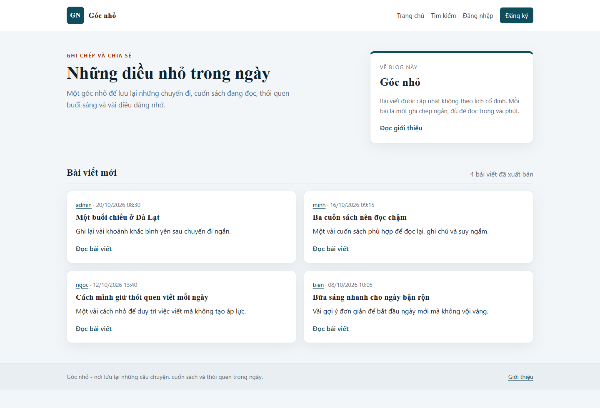
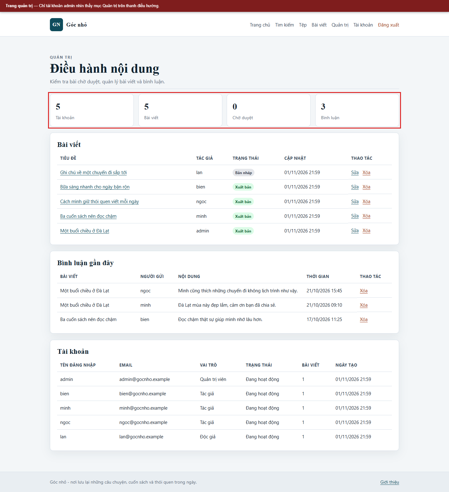

# ATUD Blog - môi trường thực hành an toàn ứng dụng web và cơ sở dữ liệu


> Mở thư mục của kịch bản để đọc lý thuyết, kỹ thuật/công cụ, dữ liệu thử, cách thực hiện, kết quả, biện pháp và bằng chứng. Chỉ chạy trong môi trường lab cục bộ bằng dữ liệu giả.

## Bắt đầu từ một kịch bản

### An toàn ứng dụng Web

| Kịch bản | Mở tài liệu |
|---|---|
| 1. Stored XSS | [Mở kịch bản 1](docs/kich-ban/web/01-stored-xss/README.md) |
| 2. Reflected XSS | [Mở kịch bản 2](docs/kich-ban/web/02-reflected-xss/README.md) |
| 3. DOM-based XSS | [Mở kịch bản 3](docs/kich-ban/web/03-dom-xss/README.md) |
| 4. CSRF đổi email | [Mở kịch bản 4](docs/kich-ban/web/04-csrf-doi-email/README.md) |
| 5. SQL Injection trong đăng nhập | [Mở kịch bản 5](docs/kich-ban/web/05-sql-injection-dang-nhap/README.md) |
| 6. Vét cạn mật khẩu | [Mở kịch bản 6](docs/kich-ban/web/06-vet-can-mat-khau/README.md) |
| 7. Cố định và phát lại mã phiên | [Mở kịch bản 7](docs/kich-ban/web/07-phat-lai-phien/README.md) |
| 8. Mã đặt lại mật khẩu yếu | [Mở kịch bản 8](docs/kich-ban/web/08-dat-lai-mat-khau/README.md) |
| 9. Lạm dụng quy trình xuất bản | [Mở kịch bản 9](docs/kich-ban/web/09-lam-dung-quy-trinh/README.md) |
| 10. Duyệt đường dẫn khi tải tệp | [Mở kịch bản 10](docs/kich-ban/web/10-duyet-duong-dan/README.md) |

### An toàn cơ sở dữ liệu

| Mục | Mở tài liệu |
|---|---|
| 1. Mật khẩu mặc định và yếu | [Mở mục 1](docs/kich-ban/csdl/01-mat-khau-yeu/README.md) |
| 2. SQL Injection tại DBMS | [Mở mục 2](docs/kich-ban/csdl/02-sql-injection-dbms/README.md) |
| 3. Quyền người dùng và nhóm quá mức | [Mở mục 3](docs/kich-ban/csdl/03-quyen-qua-muc/README.md) |
| 4. Tính năng DBMS không cần thiết | [Mở mục 4](docs/kich-ban/csdl/04-tinh-nang-khong-can-thiet/README.md) |
| 5. Quản lý cấu hình sai | [Mở mục 5](docs/kich-ban/csdl/05-quan-ly-cau-hinh/README.md) |
| 6. Tràn bộ đệm | [Mở mục 6](docs/kich-ban/csdl/06-tran-bo-dem/README.md) |
| 7. Leo thang đặc quyền | [Mở mục 7](docs/kich-ban/csdl/07-leo-thang-dac-quyen/README.md) |
| 8. Từ chối dịch vụ | [Mở mục 8](docs/kich-ban/csdl/08-tu-choi-dich-vu/README.md) |
| 9. DBMS chưa cập nhật | [Mở mục 9](docs/kich-ban/csdl/09-dbms-chua-cap-nhat/README.md) |
| 10. Dữ liệu không mã hóa | [Mở mục 10](docs/kich-ban/csdl/10-du-lieu-khong-ma-hoa/README.md) |

[Hướng dẫn chạy lab](docs/van-hanh.md) · [Nhật ký kiểm chứng](docs/kiem-chung.md) · [Cấu trúc repo](#5-cấu-trúc-thư-mục)

## Bắt đầu nhanh

Yêu cầu: Docker Engine kèm Docker Compose; các cổng `8080`, `8088`, `3307` còn trống.

```bash
cp .env.example .env
# Mở .env và đổi DB_PASSWORD, MYSQL_ROOT_PASSWORD
docker compose up -d --build
curl http://localhost:8080/health
```

Mở `http://localhost:8080/` để xem blog và `http://localhost:8088/` cho trang mô phỏng CSRF. Tài khoản mẫu:

| Tên đăng nhập | Mật khẩu | Vai trò |
|---|---|---|
| `admin` | `Admin@Lab#2026` | Quản trị viên |
| `bien` | `Bien@Lab#2026` | Tác giả |
| `minh` | `Minh@Lab#2026` | Tác giả |
| `ngoc` | `Ngoc@Lab#2026` | Tác giả |
| `lan` | `Lan@Lab#2026` | Độc giả |

Trên Windows, thay `cp .env.example .env` bằng `Copy-Item .env.example .env`.

Hướng dẫn đầy đủ, cách chuyển cấu hình và đặt lại dữ liệu ở mục 7, 8, 9 và 13.

## 1. Giới thiệu

Đây là mã nguồn của một blog nhỏ dùng PHP, Apache và MySQL LTS, phục vụ đồ án môn An toàn ứng dụng Web và Cơ sở dữ liệu. Ứng dụng có hai cấu hình chạy trên cùng một mã nguồn:

- `vulnerable`: chủ động vô hiệu hóa một số điểm kiểm soát để trình diễn mười kịch bản tấn công web.
- `fixed`: áp dụng các biện pháp phòng thủ tương ứng để chạy lại cùng kịch bản và đối chiếu kết quả.

Ứng dụng chỉ dùng dữ liệu giả lập. Không triển khai cấu hình `vulnerable` lên Internet. Các cổng trong Docker Compose chỉ gắn với địa chỉ loopback của máy chạy lab.

## 2. Phạm vi và cảnh báo

- Chỉ chạy trên `localhost` hoặc mạng lab do nhóm kiểm soát.
- Không dùng mật khẩu, email, tệp hoặc dữ liệu cá nhân thật.
- Không chạy các lệnh thử nghiệm trong tài liệu ra ngoài phạm vi ứng dụng của nhóm.
- Cấu hình `vulnerable` là cấu hình cố ý có lỗi, không phải cấu hình triển khai.
- Các kịch bản tràn bộ đệm và từ chối dịch vụ chỉ được kiểm tra bằng giới hạn đầu vào, cấu hình và phép đo có kiểm soát; không chạy khai thác phá hoại trên MySQL.

## 3. Kiến trúc

| Thành phần | Lựa chọn |
|---|---|
| Ngôn ngữ | PHP |
| Máy chủ web | Apache |
| Cơ sở dữ liệu | MySQL LTS |
| Kết nối | PDO MySQL, truy vấn tham số hóa ở cấu hình đã vá |
| Giao diện | HTML, CSS, JavaScript |
| Đóng gói | Docker Compose |
| Kiểm thử | curl, trình duyệt, công cụ dòng lệnh MySQL |

Luồng xử lý chính:

```text
Trình duyệt
    |
    v
Apache + PHP (public/index.php)
    |
    +-- Lớp kiểm soát: phiên, CSRF, phân quyền, kiểm tra đầu vào
    |
    +-- Lớp nghiệp vụ: bài viết, bình luận, tệp, đặt lại mật khẩu
    |
    v
MySQL LTS (schema atud_blog)
```

Mã nguồn nằm ngoài thư mục công khai. Tệp tải lên được lưu trong `app/storage/uploads`, không nằm trong `app/public`, nên không thể thực thi trực tiếp qua máy chủ web.

## 4. Chức năng

- Xem danh sách, chi tiết và tìm kiếm bài viết.
- Đăng ký, đăng nhập, đăng xuất.
- Bình luận bài viết.
- Đổi email, đổi mật khẩu, yêu cầu đặt lại mật khẩu.
- Tải lên, tải xuống và xem tệp mẫu.
- Khu vực tác giả: tạo, sửa, xóa bài viết; lưu nháp và gửi duyệt.
- Khu vực quản trị: duyệt bài, xuất bản, xóa bài viết và bình luận.
- Trang minh họa DOM để quan sát khác biệt giữa `innerHTML` và `textContent`.
- Điểm kiểm tra trạng thái `/health`.






## 5. Cấu trúc thư mục

```text
.
├── app
│   ├── public              # thư mục gốc của máy chủ web
│   │   ├── assets          # CSS, JavaScript
│   │   ├── .htaccess
│   │   └── index.php       # bộ định tuyến
│   ├── src
│   │   ├── Controllers
│   │   ├── Core
│   │   └── helpers.php
│   ├── views
│   └── storage
│       ├── logs
│       ├── private         # tệp mồi cho kịch bản duyệt đường dẫn
│       ├── sessions
│       └── uploads         # tệp công khai và tệp riêng
├── attacker                # trang mô phỏng CSRF, chạy ở cổng riêng
├── docker
│   ├── mysql
│   └── php
├── docs
│   ├── README.md             # mục lục tài liệu
│   ├── bang-chung
│   ├── hinh
│   ├── kich-ban
│   │   ├── web
│   │   │   ├── README.md
│   │   │   └── 01-stored-xss/ ... 10-duyet-duong-dan/
│   │   └── csdl
│   │       ├── README.md
│   │       └── 01-mat-khau-yeu/ ... 10-du-lieu-khong-ma-hoa/
│   ├── kich-ban-web.md          # lối vào nhóm kịch bản Web
│   ├── loi-hong-csdl.md         # lối vào nhóm mục CSDL
│   ├── kiem-chung.md
│   ├── phan-cong.md
│   └── van-hanh.md
├── scripts
│   ├── kiem-chung-web.sh
│   ├── mysql-app.sh
│   ├── mysql-root.sh
│   └── reset-lab.sh
├── docker-compose.yml
└── .env.example
```

## 6. Yêu cầu

- Docker Engine kèm Docker Compose.
- Cổng `8080`, `8088` và `3307` còn trống trên máy.
- Khoảng 1 GB dung lượng trống cho image và dữ liệu lab.

## 7. Khởi chạy

```bash
cp .env.example .env
```

Mở `.env`, thay `DB_PASSWORD` và `MYSQL_ROOT_PASSWORD` bằng giá trị riêng. Giữ `APP_MODE=fixed` cho lần chạy đầu.

```bash
docker compose up -d --build
docker compose ps
curl http://localhost:8080/health
```

Kết quả mong đợi:

```json
{"status":"ok","database":"ok"}
```

Mở `http://localhost:8080/`. Trang mô phỏng CSRF ở `http://localhost:8088/`.

Trên Windows, có thể dùng `Copy-Item .env.example .env` thay cho `cp`.

## 8. Tài khoản lab

| Tên đăng nhập | Mật khẩu | Vai trò |
|---|---|---|
| `admin` | `Admin@Lab#2026` | Quản trị viên |
| `bien` | `Bien@Lab#2026` | Tác giả |
| `minh` | `Minh@Lab#2026` | Tác giả |
| `ngoc` | `Ngoc@Lab#2026` | Tác giả |
| `lan` | `Lan@Lab#2026` | Độc giả |

Đây là mật khẩu công khai dành cho lab. Không dùng lại cho bất kỳ hệ thống nào khác. Khi chạy lệnh trong shell, đặt mật khẩu trong dấu nháy đơn để ký tự `#` không bị hiểu là chú thích.

## 9. Chuyển cấu hình có lỗi và đã vá

Mặc định ứng dụng chạy ở cấu hình đã vá. Để trình diễn cấu hình có lỗi, sửa `.env`:

```dotenv
APP_MODE=vulnerable
```

Sau đó tạo lại dịch vụ ứng dụng:

```bash
docker compose up -d --force-recreate app
curl http://localhost:8080/health
docker compose exec -T app printenv APP_MODE
```

Kết quả mong đợi: `health` trả trạng thái `ok`; `APP_MODE` là `vulnerable`.

Quay lại cấu hình đã vá bằng cách đặt `APP_MODE=fixed` và lặp lại lệnh tạo lại dịch vụ. Có thể đặt biến môi trường trực tiếp cho một lần chạy:

```bash
APP_MODE=vulnerable docker compose up -d --force-recreate app
```

Không cần tạo lại cơ sở dữ liệu khi chuyển cấu hình. Tuy nhiên, nên đặt lại dữ liệu trước mỗi buổi trình diễn để trạng thái bài viết, bình luận và mật khẩu về mặc định.

## 10. Ma trận kịch bản web

| Mã | Kịch bản | Chức năng | Kết quả bản có lỗi | Biện pháp ở bản đã vá |
|---|---|---|---|---|
| W1 | Stored XSS | Bình luận | Mã script được lưu và thực thi khi mở bài viết | Mã hóa đầu ra theo ngữ cảnh HTML |
| W2 | Reflected XSS | Tìm kiếm | Chuỗi tìm kiếm được phản hồi vào HTML | Mã hóa từ khóa khi hiển thị |
| W3 | DOM-based XSS | Trang minh họa DOM | Tham số URL được gán vào `innerHTML` | Dùng `textContent` |
| W4 | CSRF | Đổi email | Biểu mẫu từ cổng khác được chấp nhận | Kiểm tra mã CSRF và `SameSite=Strict` |
| W5 | SQL Injection | Đăng nhập | Chuỗi `' OR '1'='1' -- ` vượt qua xác thực | Truy vấn tham số hóa và `password_verify` |
| W6 | Vét cạn mật khẩu | Đăng nhập | Không giới hạn số lần thử | Giới hạn 5 lần trong 15 phút |
| W7 | Cố định và phát lại phiên | Phiên đăng nhập | Mã phiên không đổi sau đăng nhập, không bị thu hồi khi đăng xuất | Đổi mã phiên, hủy phiên, cờ cookie |
| W8 | Mã đặt lại mật khẩu yếu | Quên mật khẩu | Mã dễ đoán và dùng lại được | Mã ngẫu nhiên, hết hạn, dùng một lần |
| W9 | Lạm dụng quy trình | Xuất bản bài viết | Tài khoản độc giả tự đặt `status=published` | Kiểm tra vai trò, chủ sở hữu và trạng thái |
| W10 | Duyệt đường dẫn | Tải tệp | Đọc được tệp ngoài thư mục công khai | Chỉ nhận mã tệp, chuẩn hóa và giới hạn thư mục |

Chi tiết lệnh, kết quả quan sát và cách đặt lại dữ liệu nằm trong [hướng dẫn kịch bản Web](docs/kich-ban/web/README.md).

## 11. Ma trận lỗ hổng cơ sở dữ liệu

| Mã | Mục kiểm tra | Cách kiểm tra | Biện pháp và bằng chứng |
|---|---|---|---|
| D1 | Mật khẩu mặc định và yếu | Thử mật khẩu yếu với tài khoản ứng dụng | Mật khẩu mạnh, không có tài khoản ẩn danh, dùng `caching_sha2_password` |
| D2 | SQL Injection tại DBMS | So sánh truy vấn ghép chuỗi và truy vấn tham số hóa | Ứng dụng dùng prepared statement; đầu vào không đổi nghĩa truy vấn |
| D3 | Quyền người dùng và nhóm quá mức | Kiểm tra `SHOW GRANTS` của `atud_app` | Chỉ `SELECT`, `INSERT`, `UPDATE`, `DELETE` trên một lược đồ |
| D4 | Tính năng DBMS không cần thiết | Liệt kê plugin, `local_infile`, MySQL X | Tắt `local_infile`, tắt MySQL X, không cấp `FILE` |
| D5 | Quản lý cấu hình sai | Kiểm tra vị trí bí mật, tệp `.env`, nhật ký | Bí mật nằm trong biến môi trường; `.env` bị loại khỏi Git và Docker context |
| D6 | Tràn bộ đệm | Gửi đầu vào vượt giới hạn vào tìm kiếm | Giới hạn độ dài, `max_allowed_packet`, runtime được quản lý và vá |
| D7 | Leo thang đặc quyền | Tài khoản thường gọi trang quản trị; tài khoản DB thử thao tác quản trị | Kiểm tra vai trò ở máy chủ; tài khoản DB bị từ chối |
| D8 | Từ chối dịch vụ | Đo truy vấn `SLEEP` có giới hạn, kiểm tra cấu hình | `max_execution_time`, `max_connections`, giới hạn kết quả và tần suất |
| D9 | DBMS chưa cập nhật | Ghi nhận phiên bản và nguồn image | Dùng image `mysql:lts`, có quy trình cập nhật và kiểm tra lại |
| D10 | Dữ liệu không mã hóa | Kiểm tra mật khẩu và mã đặt lại trong CSDL | Băm mật khẩu bằng bcrypt; mã đặt lại lưu dạng băm SHA-256 |

Chi tiết lệnh và kết quả nằm trong [hướng dẫn kiểm tra CSDL](docs/kich-ban/csdl/README.md).

## 12. Kiểm chứng

Chạy từng kịch bản web:

```bash
BASE_URL=http://localhost:8080 bash scripts/kiem-chung-web.sh 01
BASE_URL=http://localhost:8080 bash scripts/kiem-chung-web.sh 05
```

Xem toàn bộ mã và cách diễn giải trong [docs/kiem-chung.md](docs/kiem-chung.md). Kết quả thô được lưu trong `docs/bang-chung`.

## 13. Đặt lại dữ liệu

Cách đầy đủ, xóa cả cơ sở dữ liệu và tệp tải lên:

```bash
docker compose down -v
docker compose up -d --build
```

Trên Windows:

```powershell
powershell -ExecutionPolicy Bypass -File scripts/reset-lab.ps1
```

Sau khi đặt lại, chạy lại `curl http://localhost:8080/health` trước khi trình diễn.

## 14. Tài liệu

- [Kịch bản tấn công web](docs/kich-ban/web/README.md)
- [Mười mục cơ sở dữ liệu](docs/kich-ban/csdl/README.md)
- [Kiểm chứng và bằng chứng](docs/kiem-chung.md)
- [Hướng dẫn vận hành](docs/van-hanh.md)
- [Phân công công việc](docs/phan-cong.md)
- [Hình ảnh kiểm chứng](docs/hinh/web/README.md)

Báo cáo Word và slide bảo vệ được giữ ngoài kho mã nguồn để tránh đưa tài liệu trình bày vào lịch sử Git.

## 15. Giới hạn

- Ứng dụng là môi trường lab, không phải sản phẩm triển khai thật.
- TLS, sao lưu mã hóa và giám sát tập trung chỉ được mô tả trong báo cáo, chưa cấu hình đầy đủ trong môi trường cục bộ.
- Cột `password_legacy` tồn tại có chủ đích để tái hiện kịch bản SQL Injection. Cột này không được dùng trong xác thực ở cấu hình đã vá và cần được loại bỏ khi chuyển sang triển khai thật.
- Kết quả tràn bộ đệm và từ chối dịch vụ trong tài liệu là kết quả kiểm tra giới hạn và cấu hình, không phải khai thác phá hoại.
