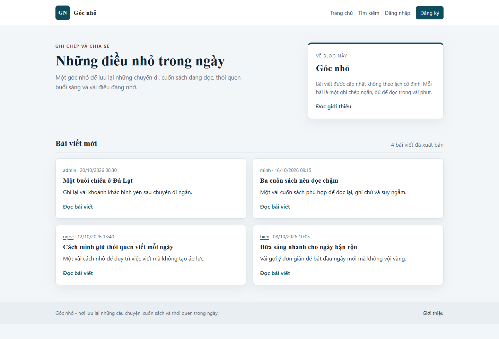
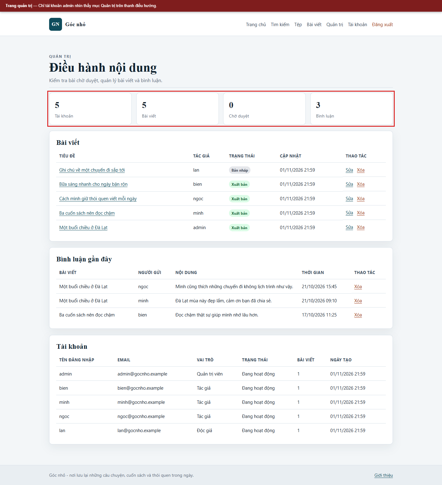

# Hình ảnh kiểm chứng

Thư mục này lưu ảnh chụp giao diện và kết quả của các kịch bản. Ảnh được chụp ở kích thước 1440 pixel, có thanh chú thích đỏ ghi rõ kịch bản, vị trí nhập và kết quả. Các ảnh chỉ dùng dữ liệu giả lập của lab.

## 1. Giao diện ban đầu

| Tệp | Nội dung |
|---|---|
| `01-trang-chu.png` | Trang chủ của blog ở cấu hình có lỗi. |
| `02-dang-ky.png` | Biểu mẫu đăng ký tài khoản. |
| `03-quan-tri.png` | Trang quản trị dành cho tài khoản admin. |
| `04-viet-bai.png` | Khu vực viết bài của tác giả. |

## 2. Kịch bản trên cấu hình có lỗi

| Tệp | Kịch bản | Vị trí nhập hoặc thao tác | Kết quả |
|---|---|---|---|
| `05-sqli-nhap.png` | SQL Injection | Nhập `' OR '1'='1' -- ` vào ô tên đăng nhập, mật khẩu bất kỳ. | Biểu mẫu trước khi gửi. |
| `06-sqli-ket-qua.png` | SQL Injection | Gửi biểu mẫu đăng nhập. | Vào được trang quản trị của admin. |
| `07-stored-xss-nhap.png` | Stored XSS | Nhập thẻ script vào ô bình luận của bài viết. | Biểu mẫu trước khi gửi. |
| `08-stored-xss-ket-qua.png` | Stored XSS | Gửi bình luận và tải lại bài viết. | Tiêu đề bài viết bị script thay đổi. |
| `09-reflected-xss.png` | Reflected XSS | Đưa payload vào tham số `q` của URL tìm kiếm. | Payload nằm trong kết quả và được thực thi. |
| `10-dom-xss.png` | DOM XSS | Đưa payload vào tham số `q` của trang DOM. | Payload được gán vào `innerHTML` và thực thi. |
| `11-csrf-nhap.png` | CSRF | Mở trang mô phỏng ở cổng 8088, nhập email mới. | Biểu mẫu gửi tới ứng dụng ở cổng 8080. |
| `12-csrf-ket-qua.png` | CSRF | Gửi biểu mẫu khi đang đăng nhập. | Email tài khoản đổi thành email của kẻ tấn công. |
| `13-brute-force.png` | Vét cạn mật khẩu | Nhập sai mật khẩu năm lần tại ô đăng nhập. | Biểu mẫu vẫn cho phép thử tiếp. |
| `14-session-replay.png` | Phát lại phiên | Dùng lại cookie phiên sau khi đăng xuất. | Cookie cũ vẫn mở được trang tài khoản. |
| `15-reset-nhap.png` | Mã đặt lại yếu | Nhập email tại trang quên mật khẩu. | Trang hiển thị liên kết chứa mã 20 ký tự. |
| `16-reset-ket-qua.png` | Mã đặt lại yếu | Mở lại liên kết sau khi đã đặt lại mật khẩu. | Biểu mẫu vẫn dùng lại được. |
| `17-workflow-nhap.png` | Lạm dụng quy trình | Tài khoản độc giả chọn trạng thái Xuất bản trong biểu mẫu sửa bài. | Biểu mẫu trước khi gửi. |
| `18-workflow-ket-qua.png` | Lạm dụng quy trình | Gửi biểu mẫu. | Bài viết được xuất bản mà không qua duyệt. |
| `19-traversal.png` | Duyệt đường dẫn | Mở `/download?file=../private/demo-secret.txt`. | Nội dung tệp riêng được trả về. |

## 3. Kịch bản trên cấu hình đã vá

| Tệp | Kịch bản | Kết quả |
|---|---|---|
| `21-stored-xss-da-va.png` | Stored XSS | Script được mã hóa, hiển thị thành văn bản. |
| `22-reflected-xss-da-va.png` | Reflected XSS | Từ khóa được mã hóa, không thực thi. |
| `23-dom-xss-da-va.png` | DOM XSS | Dùng `textContent`, không tạo phần tử HTML. |
| `24-csrf-da-va.png` | CSRF | Biểu mẫu tại trang mô phỏng trước khi gửi. |
| `25-csrf-ket-qua-da-va.png` | CSRF | Máy chủ trả 403, email không đổi. |
| `26-sqli-nhap-da-va.png` | SQL Injection | Cùng payload được nhập vào ô đăng nhập. |
| `27-sqli-ket-qua-da-va.png` | SQL Injection | Trả 200, từ chối đăng nhập. |
| `28-brute-force-da-va.png` | Vét cạn mật khẩu | Khóa tạm sau năm lần sai, trả 429. |
| `29-session-da-va.png` | Phát lại phiên | Cookie cũ bị chuyển về trang đăng nhập. |
| `30-reset-da-va.png` | Mã đặt lại | Thông báo không tiết lộ tài khoản có tồn tại. |
| `31-reset-ket-qua-da-va.png` | Mã đặt lại | Liên kết đã dùng bị từ chối. |
| `32-workflow-da-va.png` | Lạm dụng quy trình | Độc giả không thấy trạng thái Xuất bản. |
| `33-workflow-ket-qua-da-va.png` | Lạm dụng quy trình | Yêu cầu trực tiếp nhận 403. |
| `34-traversal-da-va.png` | Duyệt đường dẫn | Yêu cầu nhận 400. |

## 4. Cách chụp lại

Ảnh được chụp bằng Chrome headless trong môi trường lab. Trước khi chụp, dữ liệu được đặt lại bằng `docker compose down -v` và `docker compose up -d --build`; hai cấu hình chạy ở cổng 8080 và 8081. Không dùng ảnh cho mục đích ngoài báo cáo.
