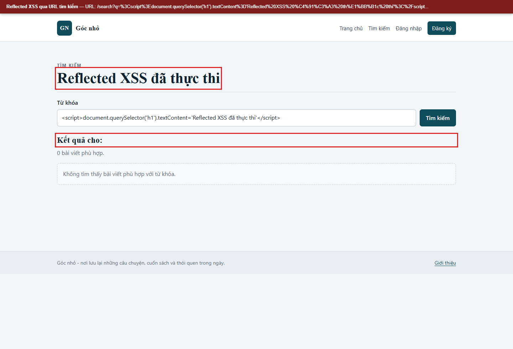
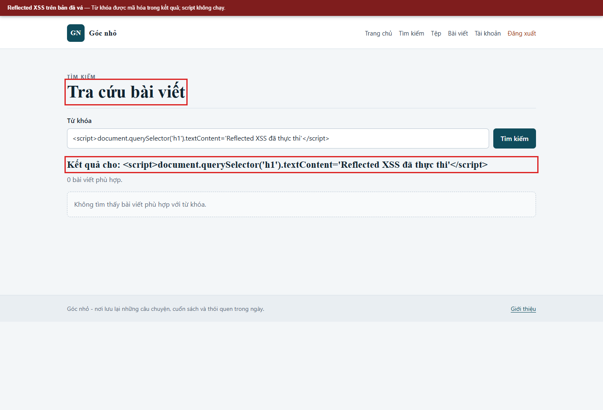

# Kịch bản 2. Reflected XSS

Tài liệu này trình bày riêng kịch bản, quy trình kiểm chứng, kết quả và biện pháp phòng thủ. Quy ước môi trường chung nằm trong [hướng dẫn kịch bản Web](../README.md).

## Lý thuyết

Dữ liệu từ tham số yêu cầu được phản hồi ngay trong trang kết quả.

## Kỹ thuật và công cụ sử dụng

Đưa chuỗi đánh dấu vào tham số tìm kiếm để kiểm tra dữ liệu phản hồi vào trang kết quả.

**Dữ liệu thử:** Tham số `q` và chuỗi minh họa vô hại trong lab.

**Công cụ và giao diện:** Trình duyệt hoặc `curl`; trang `/search`.

**Mã nguồn liên quan:** [`app/views/search.php`](../../../../app/views/search.php), [`app/src/Controllers/PostController.php`](../../../../app/src/Controllers/PostController.php).

## Môi trường và dữ liệu thử

Không cần đăng nhập. Mở `/search` trên cấu hình có lỗi và cấu hình đã vá, truyền từ khóa qua tham số `q`.

## Cách thực hiện

```bash
PAYLOAD="<script>alert('reflected-demo')</script>"
curl -sS -G --data-urlencode "q=$PAYLOAD" "$BASE/search" | grep -n "reflected-demo"
```

Có thể thực hiện bằng trình duyệt: mở `/search`, nhập cùng payload vào ô từ khóa và gửi biểu mẫu; giá trị `q` xuất hiện trên URL kết quả.

## Kết quả trên cấu hình có lỗi

```text
... <h2 class="search-summary">Kết quả cho: <script>alert('reflected-demo')</script></h2> ...
```

Mã script nằm trong thẻ `h2`. Trình duyệt thực thi ngay khi tải trang. Nguyên nhân là `app/views/search.php` in `$q` trực tiếp ở cấu hình có lỗi.

## Biện pháp phòng thủ

Mã hóa từ khóa khi hiển thị, giới hạn độ dài từ khóa ở cấu hình đã vá và không đưa dữ liệu yêu cầu vào HTML thô.

## Kết quả trên cấu hình đã vá

```bash
curl -sS -G --data-urlencode "q=$PAYLOAD" "$BASE/search" | grep -n "search-summary"
```

Kết quả:

```text
... <h2 class="search-summary">Kết quả cho: &lt;script&gt;alert(&#039;reflected-demo&#039;)&lt;/script&gt;</h2> ...
```

Script không thực thi. Với từ khóa dài 5000 ký tự, cấu hình đã vá trả về `400`; cấu hình có lỗi trả về `200`.


## Ảnh minh chứng

**Reflected XSS qua URL tìm kiếm.**



**Reflected XSS trên bản đã vá.**


