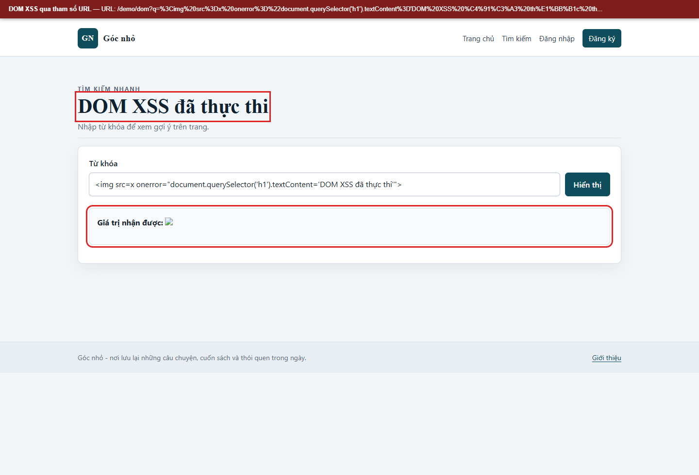
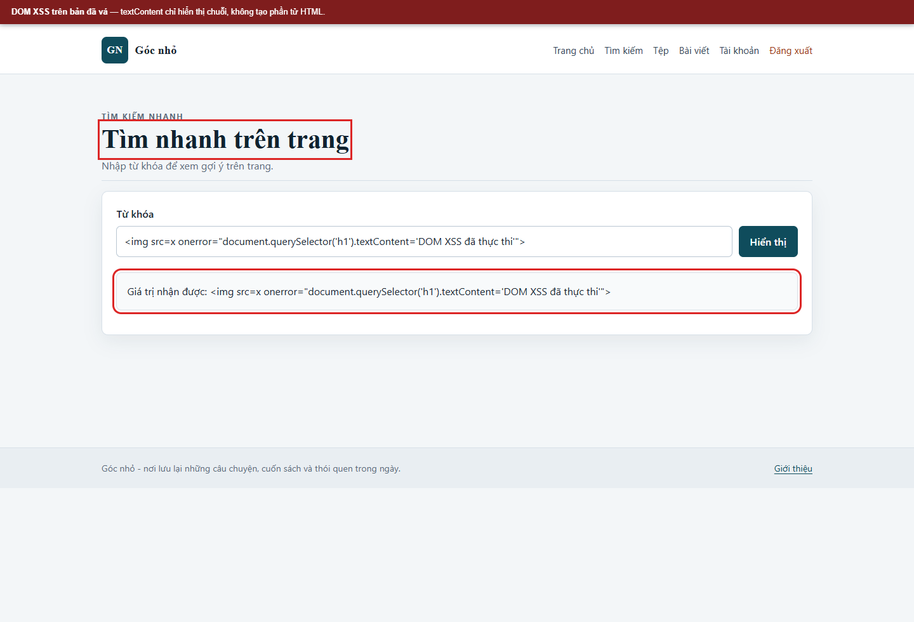

# Kịch bản 3. DOM-based XSS

Tài liệu này trình bày riêng kịch bản, quy trình kiểm chứng, kết quả và biện pháp phòng thủ. Quy ước môi trường chung nằm trong [hướng dẫn kịch bản Web](../README.md).

## Lý thuyết

Mã JavaScript phía trình duyệt đọc dữ liệu không tin cậy từ URL và ghi vào một điểm nguy hiểm của DOM.

## Kỹ thuật và công cụ sử dụng

Theo dõi dữ liệu từ URL đi vào DOM qua JavaScript phía trình duyệt.

**Dữ liệu thử:** Tham số URL `q`; so sánh sink `innerHTML` với `textContent`.

**Công cụ và giao diện:** Trình duyệt, DevTools và tệp JavaScript demo.

**Mã nguồn liên quan:** [`app/views/dom.php`](../../../../app/views/dom.php), [`app/public/assets/dom-vulnerable.js`](../../../../app/public/assets/dom-vulnerable.js), [`app/public/assets/dom-fixed.js`](../../../../app/public/assets/dom-fixed.js).

## Môi trường và dữ liệu thử

Không cần đăng nhập. Mở `/demo/dom` trên hai cấu hình; tham số `q` được JavaScript đọc trực tiếp từ URL.

## Cách thực hiện

Mở trình duyệt tại:

```text
http://localhost:8080/demo/dom?q=%3Cimg%20src%3Dx%20onerror%3Dalert%28%27dom-demo%27%29%3E
```

Kiểm tra tệp JavaScript được nạp:

```bash
curl -sS "$BASE/demo/dom" | grep -o 'dom-[a-z]*\.js'
curl -sS "$BASE/assets/dom-vulnerable.js"
```

## Kết quả trên cấu hình có lỗi

```text
dom-vulnerable.js
output.innerHTML = '<p><strong>Giá trị nhận được:</strong> ' + value + '</p>';
```

Trình duyệt tạo thẻ `img`, gán `src=x`, sự kiện `onerror` kích hoạt và hiện hộp thoại `dom-demo`. Máy chủ không tham gia vào bước này; toàn bộ quá trình diễn ra trong DOM.

## Biện pháp phòng thủ

Dùng `textContent` thay cho `innerHTML` khi chỉ cần hiển thị văn bản. Không đưa dữ liệu từ `location.search` vào API HTML.

## Kết quả trên cấu hình đã vá

```bash
curl -sS "$BASE/demo/dom" | grep -o 'dom-[a-z]*\.js'
curl -sS "$BASE/assets/dom-fixed.js"
```

Kết quả:

```text
dom-fixed.js
output.textContent = 'Giá trị nhận được: ' + value;
```

Cùng URL thử nghiệm, trình duyệt hiển thị chuỗi ký tự thay vì tạo phần tử ảnh. CSP không can thiệp vào phép gán `textContent`.


## Ảnh minh chứng

**DOM XSS qua tham số URL.**



**DOM XSS trên bản đã vá.**


