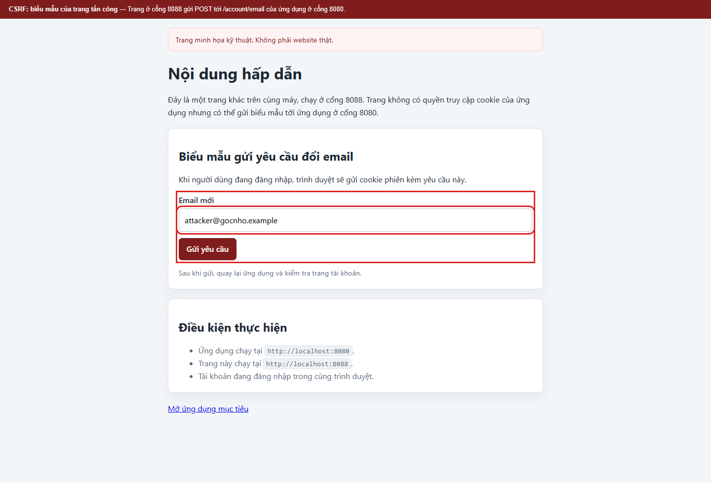
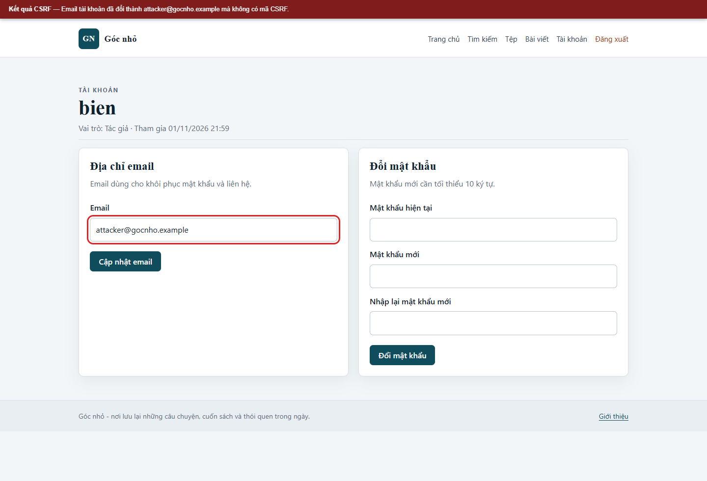
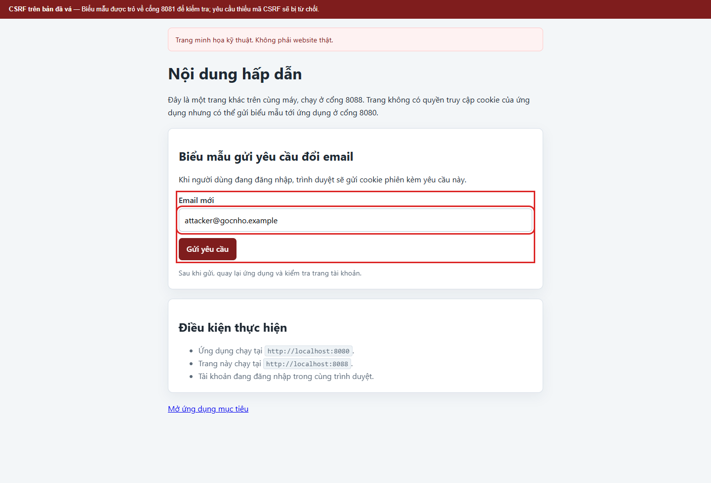
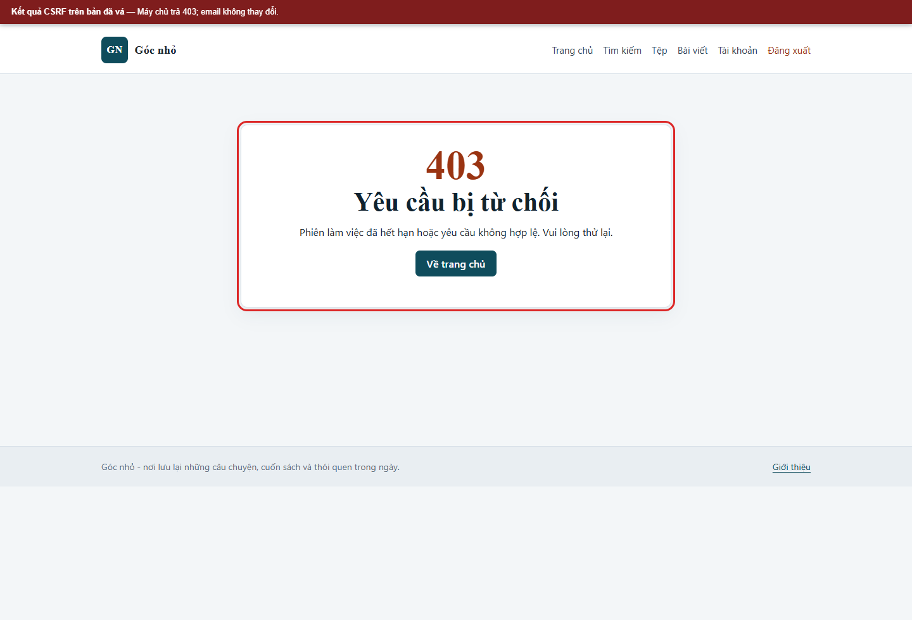

# Kịch bản 4. CSRF đổi email

Tài liệu này trình bày riêng kịch bản, quy trình kiểm chứng, kết quả và biện pháp phòng thủ. Quy ước môi trường chung nằm trong [hướng dẫn kịch bản Web](../README.md).

## Lý thuyết

Ứng dụng thay đổi trạng thái dựa trên cookie phiên nhưng không kiểm tra mã chống CSRF.

## Kỹ thuật và công cụ sử dụng

Gửi một yêu cầu thay đổi trạng thái từ origin khác khi tài khoản lab đang đăng nhập.

**Dữ liệu thử:** Biểu mẫu HTML trên cổng attacker lab gửi tới endpoint đổi email.

**Công cụ và giao diện:** Hai origin local ở cổng `8088` và `8080`; trình duyệt; tài khoản giả.

**Mã nguồn liên quan:** [`attacker/index.html`](../../../../attacker/index.html), [`app/src/Controllers/AccountController.php`](../../../../app/src/Controllers/AccountController.php), [`app/src/Core/Csrf.php`](../../../../app/src/Core/Csrf.php).

## Môi trường và dữ liệu thử

Đăng nhập `bien` tại `http://localhost:8080`. Mở trang mô phỏng của kẻ tấn công tại `http://localhost:8088/`.

Trang này chạy ở cổng khác nhưng cùng site `localhost`; trình duyệt vẫn gửi cookie phiên cho yêu cầu POST. Đây là điểm cần phân biệt giữa same-origin và same-site.

## Cách thực hiện

### Trình duyệt

1. Đăng nhập ứng dụng.
2. Mở `http://localhost:8088/`.
3. Nhập email mới và bấm gửi.
4. Quay lại `http://localhost:8080/account`.

### Dòng lệnh curl

```bash
curl -sS -b "$JAR" -c "$JAR" \
  --data-urlencode "email=attacker@gocnho.example" \
  -o /dev/null -w '%{http_code}\n' "$BASE/account/email"

curl -sS -b "$JAR" "$BASE/account" | grep -o 'value="[^"]*@gocnho.example"'
```

## Kết quả trên cấu hình có lỗi

```text
302
value="attacker@gocnho.example"
```

Yêu cầu không có trường `_csrf` vẫn được chấp nhận. Trong cơ sở dữ liệu, email của `bien` đổi thành `attacker@gocnho.example`.

## Biện pháp phòng thủ

Sinh mã CSRF theo phiên, gắn vào biểu mẫu và kiểm tra ở máy chủ bằng `hash_equals`. Đặt cookie phiên `SameSite=Strict` và `HttpOnly` để giảm nguy cơ gửi cookie từ site khác. Trong lab, hai cổng cùng site nên lớp quyết định là mã CSRF, không phải `SameSite`.

## Kết quả trên cấu hình đã vá

```bash
curl -sS -b "$JAR" -c "$JAR" \
  --data-urlencode "email=attacker@gocnho.example" \
  -o /dev/null -w '%{http_code}\n' "$BASE/account/email"
```

Kết quả:

```text
403
```

Trang lỗi ghi: `Phiên làm việc đã hết hạn hoặc yêu cầu không hợp lệ. Vui lòng thử lại.` Email trong trang tài khoản vẫn là `bien@gocnho.example`. Gửi lại biểu mẫu có mã CSRF hợp lệ thì cập nhật thành công.

## Dọn dữ liệu sau kiểm thử

Đổi lại email bằng giao diện hoặc đặt lại toàn bộ dữ liệu.


## Ảnh minh chứng

**CSRF: biểu mẫu tại trang mô phỏng.**



**CSRF: email bị đổi trên bản có lỗi.**



**CSRF: biểu mẫu trên bản đã vá.**



**CSRF: yêu cầu bị từ chối.**


