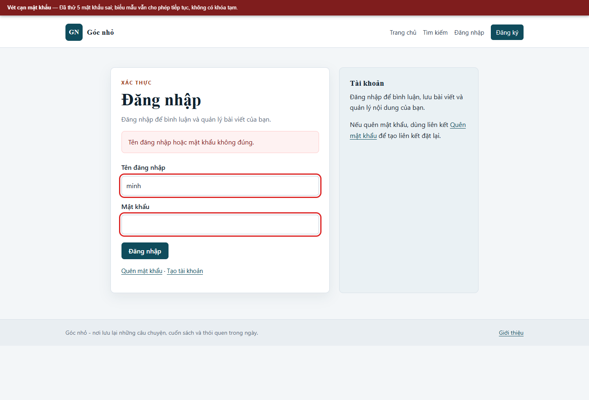
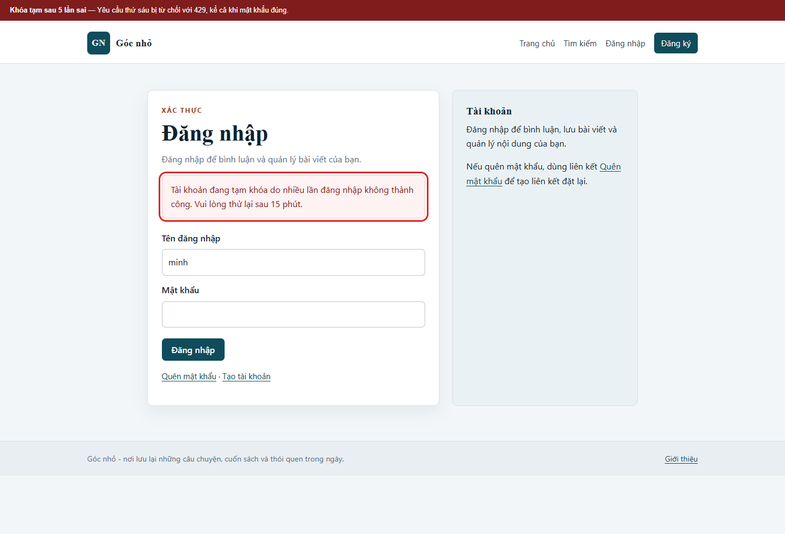

# Kịch bản 6. Vét cạn mật khẩu

Tài liệu này trình bày riêng kịch bản, quy trình kiểm chứng, kết quả và biện pháp phòng thủ. Quy ước môi trường chung nằm trong [hướng dẫn kịch bản Web](../README.md).

## Lý thuyết

Cơ chế đăng nhập không giới hạn số lần thử.

## Kỹ thuật và công cụ sử dụng

So sánh khả năng tiếp nhận nhiều lần đăng nhập sai trước và sau khi áp giới hạn thử.

**Dữ liệu thử:** Một số mật khẩu giả nhập thủ công cho tài khoản lab; không dùng wordlist hay tải lớn.

**Công cụ và giao diện:** Biểu mẫu đăng nhập hoặc `curl`; đồng hồ và mã HTTP; tài khoản giả.

**Mã nguồn liên quan:** [`app/src/Core/LoginThrottle.php`](../../../../app/src/Core/LoginThrottle.php), [`app/src/Controllers/AuthController.php`](../../../../app/src/Controllers/AuthController.php).

## Môi trường và dữ liệu thử

Dùng tài khoản `minh`; thực hiện năm lần sai liên tiếp rồi thử mật khẩu đúng. Nếu chạy lại, xóa bản ghi trong `login_attempts` trước.

## Cách thực hiện

```bash
html="$(curl -sS -c "$JAR" "$BASE/login")"
token="$(printf '%s' "$html" | sed -n 's/.*name="_csrf" value="\([^"]*\)".*/\1/p' | head -1)"

for i in 1 2 3 4 5; do
  curl -sS -b "$JAR" -c "$JAR" \
    --data-urlencode "username=minh" \
    --data-urlencode "password=sai-$i" \
    --data-urlencode "_csrf=$token" \
    -o /dev/null -w "lần $i: %{http_code}\n" "$BASE/login"
done

curl -sS -b "$JAR" -c "$JAR" \
  --data-urlencode "username=minh" \
  --data-urlencode "password=Minh@Lab#2026" \
  --data-urlencode "_csrf=$token" \
  -o /dev/null -w 'đăng nhập đúng: %{http_code}\n' "$BASE/login"
```

## Kết quả trên cấu hình có lỗi

```text
lần 1: 200
lần 2: 200
lần 3: 200
lần 4: 200
lần 5: 200
đăng nhập đúng: 302
```

Không có giới hạn. Mỗi lần sai chỉ trả về thông báo chung, nhưng người tấn công có thể tiếp tục với số lượng lớn.

## Biện pháp phòng thủ

Đếm số lần thất bại theo tên đăng nhập và địa chỉ nguồn trong cửa sổ 15 phút. Sau 5 lần, từ chối mọi yêu cầu đăng nhập trong 15 phút, kể cả khi mật khẩu đúng. Ghi nhật ký sự kiện khóa tài khoản.

## Kết quả trên cấu hình đã vá

```text
lần 1: 200
lần 2: 200
lần 3: 200
lần 4: 200
lần 5: 200
đăng nhập đúng: 429
```

Thông báo: `Tài khoản đang tạm khóa do nhiều lần đăng nhập không thành công. Vui lòng thử lại sau 15 phút.` Cơ chế đếm nằm ở `app/src/Core/LoginThrottle.php`.

## Dọn dữ liệu sau kiểm thử

```bash
docker compose down -v
docker compose up -d --build
```

Trong lúc trình diễn, có thể xóa bản ghi thử nghiệm:

```bash
bash scripts/mysql-app.sh -e "DELETE FROM login_attempts;"
```


## Ảnh minh chứng

**Vét cạn mật khẩu trên bản có lỗi.**



**Khóa tạm sau năm lần sai trên bản đã vá.**


