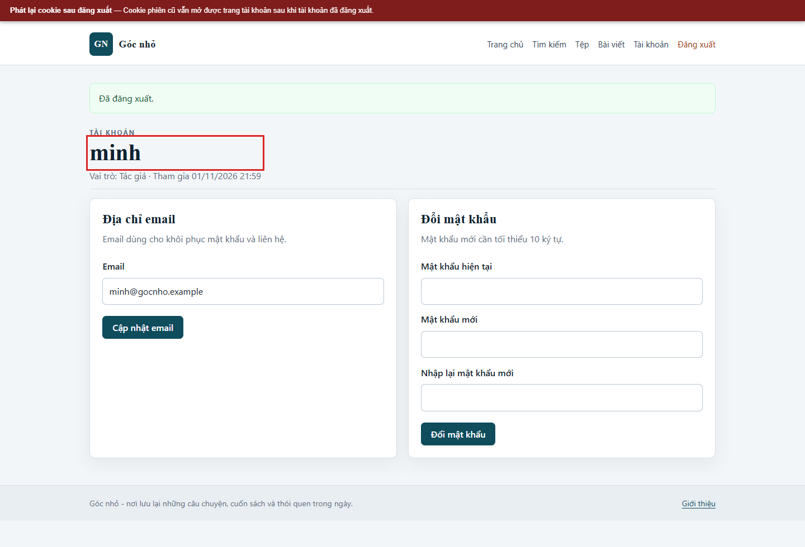
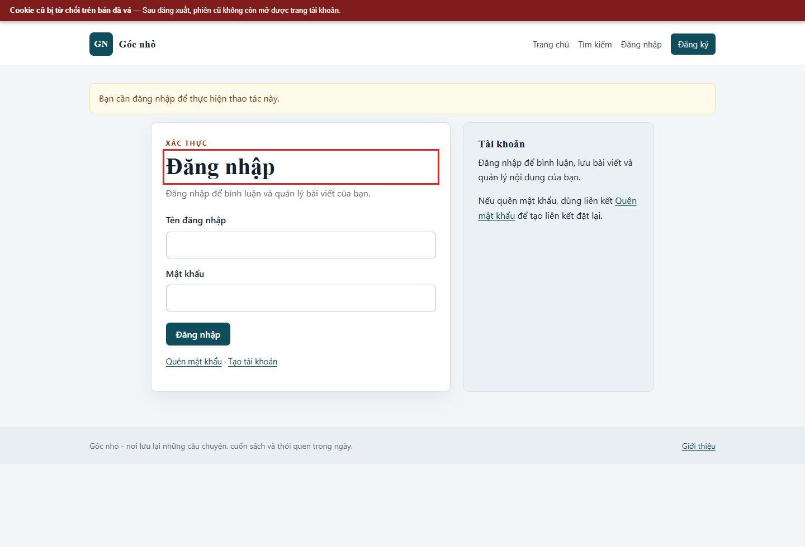

# Kịch bản 7. Cố định và phát lại mã phiên

Tài liệu này trình bày riêng kịch bản, quy trình kiểm chứng, kết quả và biện pháp phòng thủ. Quy ước môi trường chung nằm trong [hướng dẫn kịch bản Web](../README.md).

## Lý thuyết

Mã phiên không được đổi sau khi xác thực và không bị thu hồi khi đăng xuất.

## Kỹ thuật và công cụ sử dụng

So sánh mã phiên trước/sau đăng nhập và thử lại cookie của chính tài khoản lab sau khi đăng xuất.

**Dữ liệu thử:** Cookie phiên giả lập thuộc tài khoản lab; không dùng cookie của người khác.

**Công cụ và giao diện:** Trình duyệt DevTools hoặc cookie jar của `curl`; hai phiên trình duyệt local.

**Mã nguồn liên quan:** [`app/src/Core/Session.php`](../../../../app/src/Core/Session.php), [`app/src/Controllers/AuthController.php`](../../../../app/src/Controllers/AuthController.php).

## Môi trường và dữ liệu thử

Dùng tài khoản `minh`; giữ một cookie jar riêng và một mã phiên cố định. Chỉ dùng cookie của tài khoản lab do nhóm tạo.

## Cách thực hiện

Chọn một mã phiên cố định:

```bash
SID=aaaaaaaaaaaaaaaaaaaaaaaaaaaaaaaa
```

Mở trang đăng nhập và đăng nhập với mã phiên này:

```bash
curl -sS -i -c "$JAR" -H "Cookie: ATUDBLOG_SID=$SID" "$BASE/login" -o /tmp/step1.txt
token="$(sed -n 's/.*name="_csrf" value="\([^"]*\)".*/\1/p' /tmp/step1.txt | head -1)"

curl -sS -i -b "$JAR" -c "$JAR" -H "Cookie: ATUDBLOG_SID=$SID" \
  --data-urlencode "username=minh" \
  --data-urlencode "password=Minh@Lab#2026" \
  --data-urlencode "_csrf=$token" \
  "$BASE/login" -o /tmp/step2.txt

grep -i '^Set-Cookie:' /tmp/step2.txt
```

Kiểm tra phát lại trước và sau đăng xuất:

```bash
curl -sS -H "Cookie: ATUDBLOG_SID=$SID" "$BASE/account" -o /dev/null -w 'trước đăng xuất: %{http_code}\n'
curl -sS -H "Cookie: ATUDBLOG_SID=$SID" "$BASE/logout" -o /dev/null -w 'đăng xuất: %{http_code}\n'
curl -sS -H "Cookie: ATUDBLOG_SID=$SID" "$BASE/account" -o /dev/null -w 'sau đăng xuất: %{http_code}\n'
```

## Kết quả trên cấu hình có lỗi

```text
Không có Set-Cookie sau đăng nhập
trước đăng xuất: 200
đăng xuất: 302
sau đăng xuất: 200
```

Mã phiên do kẻ tấn công chọn vẫn được giữ sau đăng nhập. Đăng xuất chỉ xóa cookie ở trình duyệt hiện tại, không hủy phiên phía máy chủ. Một hồ sơ trình duyệt khác sao chép cookie cũ vẫn truy cập được trang tài khoản.

## Biện pháp phòng thủ

Đặt `session.use_strict_mode=1`, đổi mã phiên sau đăng nhập bằng `session_regenerate_id(true)`, hủy toàn bộ dữ liệu phiên và cookie khi đăng xuất. Đặt cookie `HttpOnly`, `SameSite=Strict`. Cờ cookie giảm nguy cơ lộ mã nhưng không tự thu hồi một mã đang còn hiệu lực; cần hủy phiên ở máy chủ.

## Kết quả trên cấu hình đã vá

```text
HTTP/1.1 302 Found
Set-Cookie: ATUDBLOG_SID=<mã mới>; path=/; HttpOnly; SameSite=Strict
trước đăng xuất: 200
đăng xuất: 302
sau đăng xuất: 302
```

Mã cố định ban đầu bị từ chối. Sau đăng nhập, mã phiên đổi. Sau đăng xuất, mã cũ không còn truy cập được. Cấu hình đã vá dùng chế độ phiên nghiêm ngặt, đổi mã sau đăng nhập và hủy phiên phía máy chủ khi đăng xuất.


## Ảnh minh chứng

**Phát lại cookie phiên sau đăng xuất trên bản có lỗi.**



**Cookie cũ bị từ chối trên bản đã vá.**


