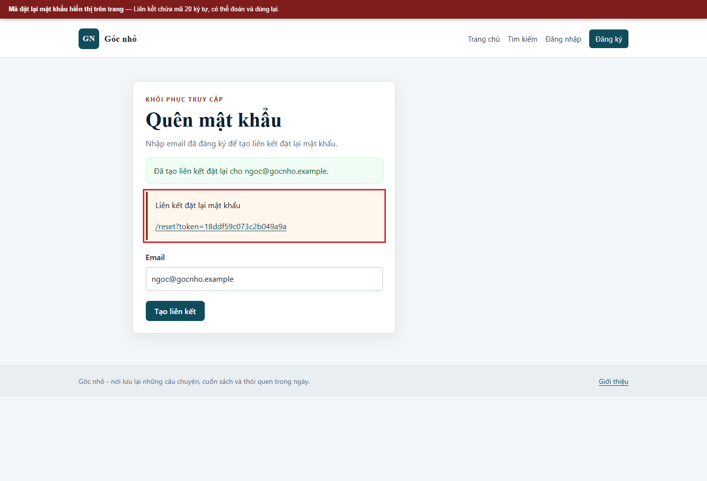
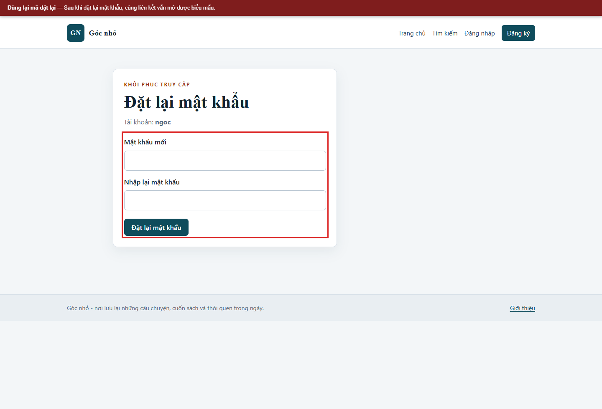
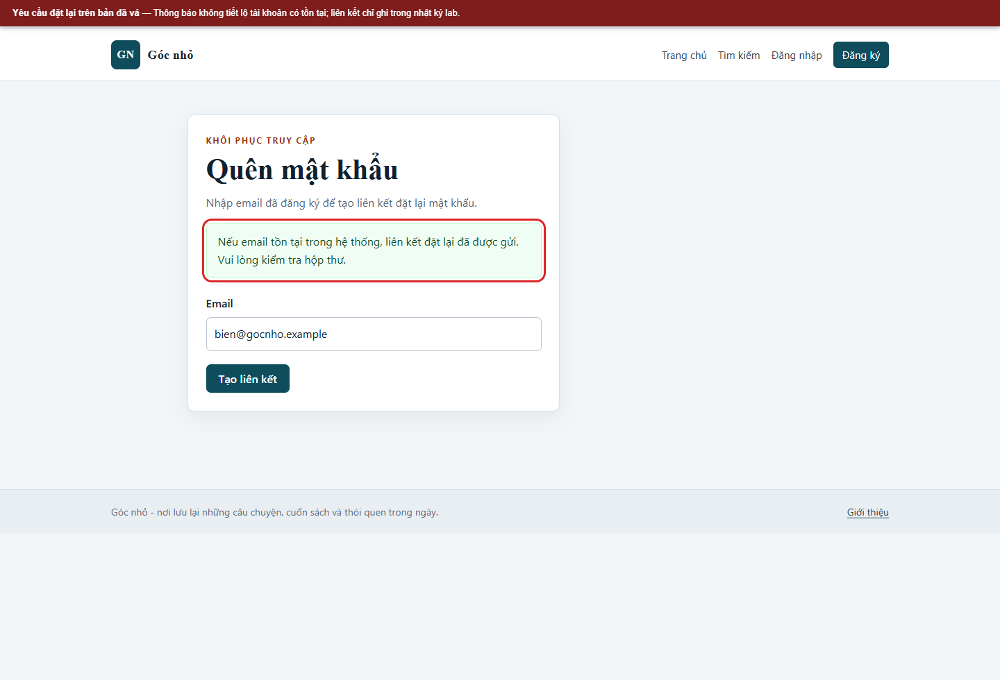
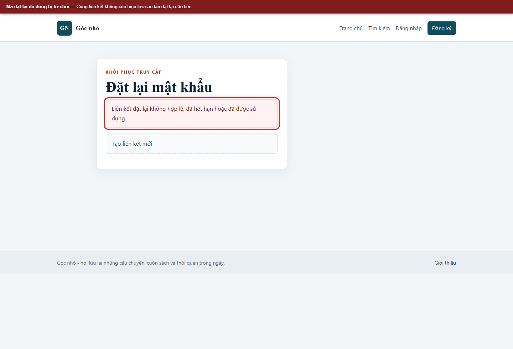

# Kịch bản 8. Mã đặt lại mật khẩu yếu

Tài liệu này trình bày riêng kịch bản, quy trình kiểm chứng, kết quả và biện pháp phòng thủ. Quy ước môi trường chung nằm trong [hướng dẫn kịch bản Web](../README.md).

## Lý thuyết

Mã đặt lại mật khẩu dễ đoán, không hết hạn hoặc dùng lại được.

## Kỹ thuật và công cụ sử dụng

Kiểm tra tính ngẫu nhiên, thời hạn, khả năng dùng lại của token và mức độ tiết lộ phản hồi.

**Dữ liệu thử:** Hai tài khoản lab; token đặt lại giả; không gửi email thật.

**Công cụ và giao diện:** Trang quên/đặt lại mật khẩu; trình duyệt hoặc `curl`; DB lab để xem trạng thái token.

**Mã nguồn liên quan:** [`app/src/Controllers/AuthController.php`](../../../../app/src/Controllers/AuthController.php), [`docker/mysql/init/01-schema.sql`](../../../../docker/mysql/init/01-schema.sql).

## Môi trường và dữ liệu thử

Dùng tài khoản `ngoc`; yêu cầu đặt lại, mở liên kết trong nhật ký, đặt lại mật khẩu rồi thử lại cùng liên kết. Không gửi email thật.

## Cách thực hiện

```bash
html="$(curl -sS -c "$JAR" "$BASE/forgot")"
token="$(printf '%s' "$html" | sed -n 's/.*name="_csrf" value="\([^"]*\)".*/\1/p' | head -1)"

curl -sS -b "$JAR" -c "$JAR" \
  --data-urlencode "email=ngoc@gocnho.example" \
  --data-urlencode "_csrf=$token" \
  "$BASE/forgot" | grep -o '/reset?token=[^"]*'
```

## Kết quả trên cấu hình có lỗi

```text
/reset?token=18ddf59c073c2b049a9a
```

Mã được tạo bằng công thức:

```bash
docker compose exec -T app php -r "echo substr(md5('ngoc|' . date('Y-m-d')), 0, 20), PHP_EOL;"
```

Kết quả trùng với mã trong liên kết. Mã có 20 ký tự hex, không đủ không gian tìm kiếm và có thể tính lại khi biết tên tài khoản cùng ngày.

Đặt lại mật khẩu lần một, sau đó mở lại đúng liên kết cũ:

```bash
curl -sS -b "$JAR" "$BASE/reset?token=18ddf59c073c2b049a9a" -o /dev/null -w '%{http_code}\n'
```

Kết quả:

```text
200
```

Biểu mẫu vẫn hiển thị và mã vẫn dùng được. Cấu hình có lỗi không kiểm tra `used_at`, không thu hồi mã cũ và không giới hạn thời gian đủ chặt.

## Biện pháp phòng thủ

Sinh mã bằng `random_bytes(32)`, lưu băm SHA-256 thay vì mã rõ, đặt hạn 30 phút, đánh dấu đã dùng trong cùng giao dịch với cập nhật mật khẩu, thu hồi các mã cũ. Trả về cùng một thông báo cho email tồn tại và không tồn tại.

## Kết quả trên cấu hình đã vá

Liên kết được ghi vào nhật ký thư của lab:

```bash
docker compose exec -T app tail -n 1 storage/logs/mail.log
```

Kết quả có dạng:

```text
[2026-11-01T20:28:37+07:00] to=<email> link=http://localhost:8080/reset?token=<64 ký tự hex>
```

Sau lần đặt lại đầu tiên, mở lại liên kết:

```text
Liên kết đặt lại không hợp lệ, đã hết hạn hoặc đã được sử dụng.
```

Gửi lại biểu mẫu với mã cũ cũng bị từ chối. Mã hết hạn sau 30 phút và mỗi tài khoản chỉ có một mã hiệu lực.

Ba trạng thái cần đối chiếu trên bản đã vá là mã sai, mã hết hạn và mã đã dùng; cả ba đều trả cùng thông báo không hợp lệ. Có thể kiểm tra mã sai bằng `curl -sS -b "$JAR" "$BASE/reset?token=khong-hop-le"`. Với mã hết hạn, cập nhật `expires_at` của một bản ghi thử trong `password_reset_tokens` về thời điểm đã qua, sau đó mở lại liên kết. Không thay đổi bản ghi ngoài lab.

## Dọn dữ liệu sau kiểm thử

Đặt lại toàn bộ dữ liệu để trả mật khẩu lab về mặc định.


## Ảnh minh chứng

**Mã đặt lại hiển thị trên trang ở bản có lỗi.**



**Dùng lại mã đặt lại trên bản có lỗi.**



**Yêu cầu đặt lại trên bản đã vá.**



**Mã đã dùng bị từ chối trên bản đã vá.**


