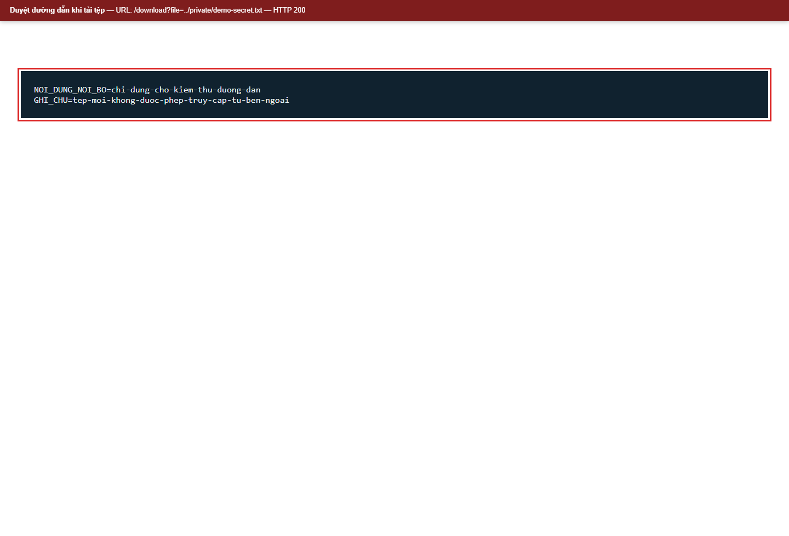
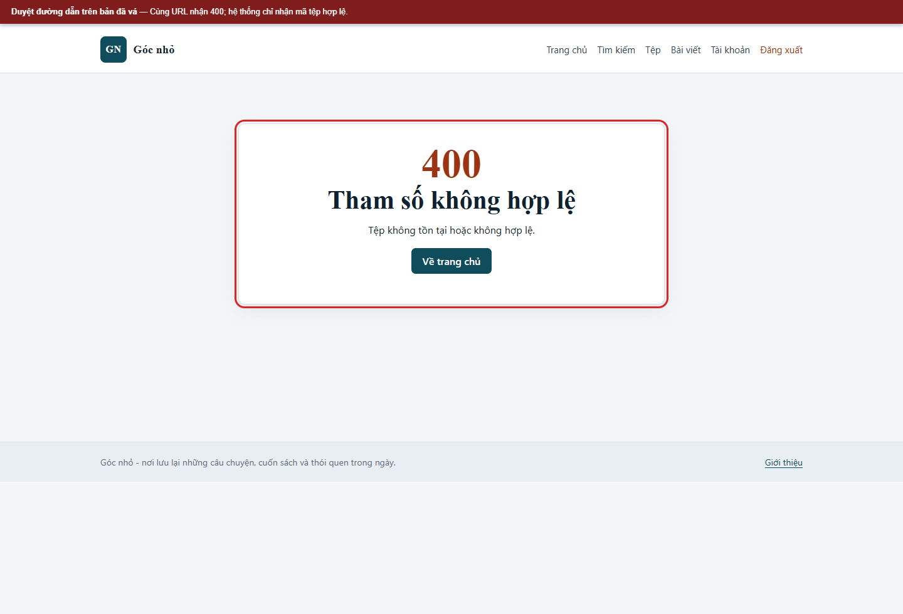

# Kịch bản 10. Duyệt đường dẫn khi tải tệp

Tài liệu này trình bày riêng kịch bản, quy trình kiểm chứng, kết quả và biện pháp phòng thủ. Quy ước môi trường chung nằm trong [hướng dẫn kịch bản Web](../README.md).

## Lý thuyết

Ứng dụng nhận đường dẫn do người dùng kiểm soát và ghép vào thư mục lưu tệp mà không chuẩn hóa.

## Kỹ thuật và công cụ sử dụng

Thay định danh tệp trong yêu cầu tải xuống để kiểm tra giới hạn thư mục.

**Dữ liệu thử:** Tệp mồi `demo-secret.txt` do nhóm tạo; đường dẫn chỉ trong storage của lab.

**Công cụ và giao diện:** Trình duyệt hoặc `curl`; endpoint `/download`.

**Mã nguồn liên quan:** [`app/src/Controllers/FileController.php`](../../../../app/src/Controllers/FileController.php), [`app/storage/private/demo-secret.txt`](../../../../app/storage/private/demo-secret.txt).

## Môi trường và dữ liệu thử

Tệp mồi `app/storage/private/demo-secret.txt` nằm ngoài thư mục công khai. Tệp công khai `id=2` là ảnh mẫu.

## Cách thực hiện

```bash
curl -sS "$BASE/download?file=../private/demo-secret.txt" -w '\n%{http_code}\n'
```

## Kết quả trên cấu hình có lỗi

```text
NOI_DUNG_NOI_BO=chi-dung-cho-kiem-thu-duong-dan
GHI_CHU=tep-moi-khong-duoc-phep-truy-cap-tu-ben-ngoai
200
```

Tham số `file` được ghép trực tiếp vào `UPLOAD_PATH`, nên `../` thoát khỏi thư mục tải lên và đọc được tệp riêng.

## Biện pháp phòng thủ

Chỉ nhận mã tệp số. Tra cứu tên tệp đã lưu trong cơ sở dữ liệu, dùng `basename`, `realpath` và kiểm tra tiền tố thư mục trước khi đọc. Kiểm tra quyền công khai, chủ sở hữu hoặc quản trị viên. Tệp lưu ngoài thư mục gốc của máy chủ web.

## Kết quả trên cấu hình đã vá

```text
HTTP/1.1 400 Bad Request
Tệp không tồn tại hoặc không hợp lệ.
```

Tệp công khai vẫn tải được:

```bash
curl -sS -o /dev/null -w '%{http_code} %{size_download}\n' "$BASE/download?id=2"
```

Kết quả:

```text
200 24853
```

Tệp riêng của người khác trả về `403`; tệp không tồn tại trả về `404`.


## Ảnh minh chứng

**Duyệt đường dẫn đọc tệp riêng trên bản có lỗi.**



**Yêu cầu duyệt đường dẫn bị chặn trên bản đã vá.**


